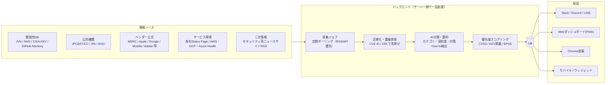
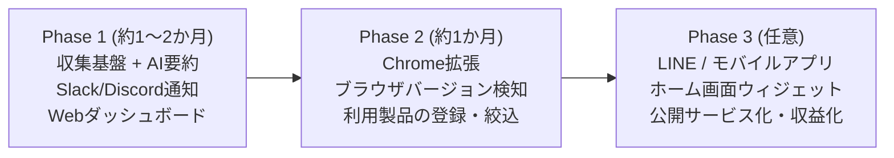

# セキュリティ情報キャッチアップBot 企画提案書

## 1. 結論（推奨構成）

> [!IMPORTANT]
> **「サーバー側で一括収集 → AIで分類・要約 → 複数チャネルへ配信」** の構成を推奨します。
> 表示形態は1つに絞らず、**Phase 1：チャット通知＋Webダッシュボード → Phase 2：Chrome拡張 → Phase 3：ウィジェット/モバイル** の段階展開が、コストと効果のバランスが最も良いです。

理由：
- 収集（クローリング）を**クライアント側でやると通信負荷・保守コストが爆発**するため、収集はサーバーに集約し、表示側は「受け取って見せるだけ」にする。
- 表示側を薄くしておけば、後から拡張機能・ウィジェット・アプリを追加しても**バックエンドを使い回せる**。

---

## 2. 表示・配信形態の比較

| 形態 | 即時性 | 開発コスト | 強み | 弱み | 評価 |
|---|---|---|---|---|---|
| **Slack / Discord / Teams Bot** | ◎ | 低 | 実装が最も簡単、チーム共有しやすい、Webhookだけで配信可 | 個人利用だと埋もれやすい | ★★★★★（最初に作る） |
| **Webダッシュボード（PWA）** | ○ | 中 | 一覧・検索・フィルタ・過去ログ閲覧の母艦。PWAならプッシュ通知も可 | 自分から見に行く必要あり | ★★★★★（母艦として必須） |
| **Chrome拡張機能** | ◎ | 中 | バッジで未読件数表示、**使用中ブラウザのバージョンを検知して「更新してください」と直接促せる**（要件4に最適） | Chrome以外は別対応、ストア審査、権限設計が重要 | ★★★★☆（Phase 2） |
| **LINE Bot** | ◎ | 低〜中 | 日本の一般ユーザーへのリーチ最強 | LINE Notifyは2025年3月終了済 → Messaging API（通数課金）が必要 | ★★★★☆（一般向けなら） |
| **デスクトップウィジェット**（Windows/macOS） | ◎ | 高 | 常時視界に入る | OSごとの開発、配布・署名・自動更新が手間 | ★★☆☆☆ |
| **スマホアプリ＋ホーム画面ウィジェット** | ◎ | 高 | プッシュ通知、外出先でも確認 | iOS/Android両対応、ストア審査、維持費 | ★★★☆☆（Phase 3） |
| **メールダイジェスト** | △ | 低 | 日次/週次まとめに向く | 緊急情報には遅い | ★★★☆☆（補助） |
| **RSS/Atom再配信** | ○ | 低 | 既存リーダーで読める | 一般ユーザーには馴染みが薄い | ★★☆☆☆（おまけ） |

### Chrome拡張でできること（要件「ブラウザ更新促し」に最適）
- `navigator.userAgentData` で使用中のChromeのバージョンを取得 → サーバーの「最新安定版」と比較 → 古ければバッジを赤にしてポップアップで更新手順を表示
- 未読の緊急アラート件数をアイコンバッジに表示
- 拡張自体はクローリングせず、**自前APIを数十分に1回取得するだけ**（通信負荷が最小）

---

## 3. システム構成

### 要件ごとの主な情報ソース

| 要件 | 一次情報（公式） | 二次情報 |
|---|---|---|
| OS/アプリの最新バージョン | Windows Release Health、Apple Security Releases、各ベンダーのリリースノート | ニュースサイト |
| インシデント注意喚起 | JPCERT/CC 注意喚起、IPA 重要なセキュリティ情報、CISA Alerts | セキュリティニュース（ScanNetSecurity, BleepingComputer 等） |
| 脆弱性対応アップデート | JVN iPedia、NVD、CISA KEV、MSRC（月例パッチ）、GitHub Security Advisories | 同上 |
| ブラウザ更新 | Chrome Releases ブログ、Mozilla Security Advisories、Edge リリースノート | 同上 |
| 現在起きている不具合 | 各社 Status Page（多くはRSS/JSON提供）、クラウド各社ヘルスダッシュボード | SNS（※API費用・規約に注意） |
| 対応策・How-to | ベンダー公式の回避策（Workaround）記載、JPCERT/CC | AI要約で抽出 |

### 技術スタック案
| 層 | 案A：Firebase / GCP（手軽） | 案B：自前サーバー（柔軟） |
|---|---|---|
| 定期実行 | Cloud Scheduler + Cloud Functions | cron + Python |
| DB | Firestore | PostgreSQL / SQLite |
| AI要約 | Gemini API | Gemini / OpenAI API |
| プッシュ | Firebase Cloud Messaging | Web Push / 各Bot API |
| 想定月額 | 個人規模なら **数百〜数千円** | VPS 1,000円前後〜 |

---

## 4. 開発にあたっての懸念事項

### 4-1. 開発コスト
| 項目 | 目安（個人開発・AI支援あり） |
|---|---|
| Phase 1：収集基盤＋AI要約＋Slack/Discord通知 | 2〜4週間 |
| Phase 1：Webダッシュボード | 2〜3週間 |
| Phase 2：Chrome拡張 | 1〜2週間（＋ストア審査 数日〜数週間） |
| Phase 3：モバイルアプリ/ウィジェット | 1〜2か月 |
| **最大のコストは初期開発より「保守」**：情報源サイトのHTML変更でスクレイパーが壊れる → **RSS/公式APIを最優先し、スクレイピングは最小限に** |

### 4-2. 通信負荷
- **クライアント（拡張・ウィジェット）に直接クローリングさせない**。ユーザー数×ソース数のアクセスになり、相手サイトへのDoS的負荷・自分のIPブロックの原因になる。
- サーバー側でも `ETag` / `If-Modified-Since` による**条件付きGET**で差分のみ取得。
- ポーリング間隔はソースごとに調整（障害情報：5〜10分、脆弱性DB：30〜60分、リリースノート：数時間）。
- 配信側はプッシュ型（Webhook / FCM）にすればクライアントのポーリングも不要。

### 4-3. 法務・規約リスク ⚠️
> [!WARNING]
> - **著作権**：記事本文の転載はNG。「タイトル＋独自要約＋元記事リンク」の形に留める。
> - **利用規約**：スクレイピングを禁止しているサイトがある（例：Downdetector等の障害情報集約サイトは規約上の制約が強い）。`robots.txt` と規約を必ず確認。
> - **X（旧Twitter）API**：有料かつ高額。SNSからの障害検知は費用対効果を要検討。
> - **免責**：誤情報・配信遅延による損害についての免責表示が必要（特に公開サービス化する場合）。

### 4-4. 情報の品質・ノイズ
- 脆弱性は**1日に100件以上**公開されるため、全件通知すると「オオカミ少年」化して誰も見なくなる。
  → CVSSスコア、**CISA KEV（実際に悪用が確認された脆弱性）掲載有無**、EPSS（悪用予測スコア）で優先度付けし、緊急のみ即時通知・他はダイジェストへ。
- **ユーザーの利用製品に絞る機能**（「Windows / Chrome / iPhoneを使っている」と登録）が満足度を大きく左右する。
- **AI要約のハルシネーション**：バージョン番号やCVE番号の誤りは致命的。番号類は元データから機械的に抽出し、AIには文章要約のみ任せる。必ず一次情報リンクを併記。

### 4-5. このツール自体のセキュリティ
> [!CAUTION]
> セキュリティ情報ツールが乗っ取られると「偽の更新を促してマルウェアを配布する」攻撃の踏み台になり得ます。
> - Chrome拡張の権限は最小限に（`<all_urls>` などは要求しない）
> - 配信内容のリンク先ドメインをホワイトリスト化
> - APIキー・Webhook URLの厳重管理、依存ライブラリの脆弱性監視（自分のツールで自分を監視する）

### 4-6. 運用面
- AI APIの従量課金（件数増加時）→ 重複排除後のみ要約、キャッシュ活用で抑制
- ソースの追加・死活監視（収集が止まったことに気づけない問題）→ 収集ジョブ自体の監視アラートを用意
- 英語ソースの日本語化品質

---

## 5. 推奨ロードマップ

---

## 6. ご確認したい点
1. **利用者は誰か**：自分（＋社内チーム）用か、一般公開サービスか → 配信チャネルと法務対応の重さが変わります
2. **普段よく使うツール**：Slack / Discord / LINE / Teams のどれか
3. **対象製品の範囲**：特定製品（Windows・Chrome・iPhone等）に絞るか、網羅型か
4. **予算感**：月額ランニングコストの上限
